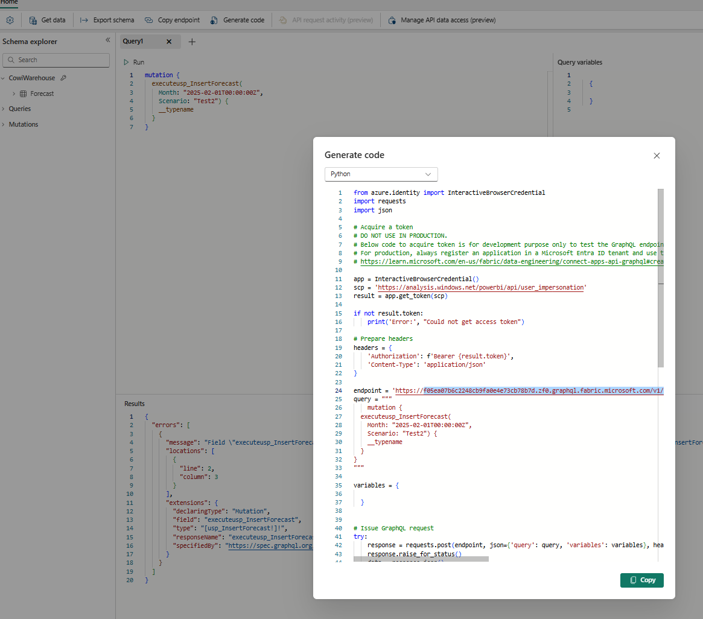
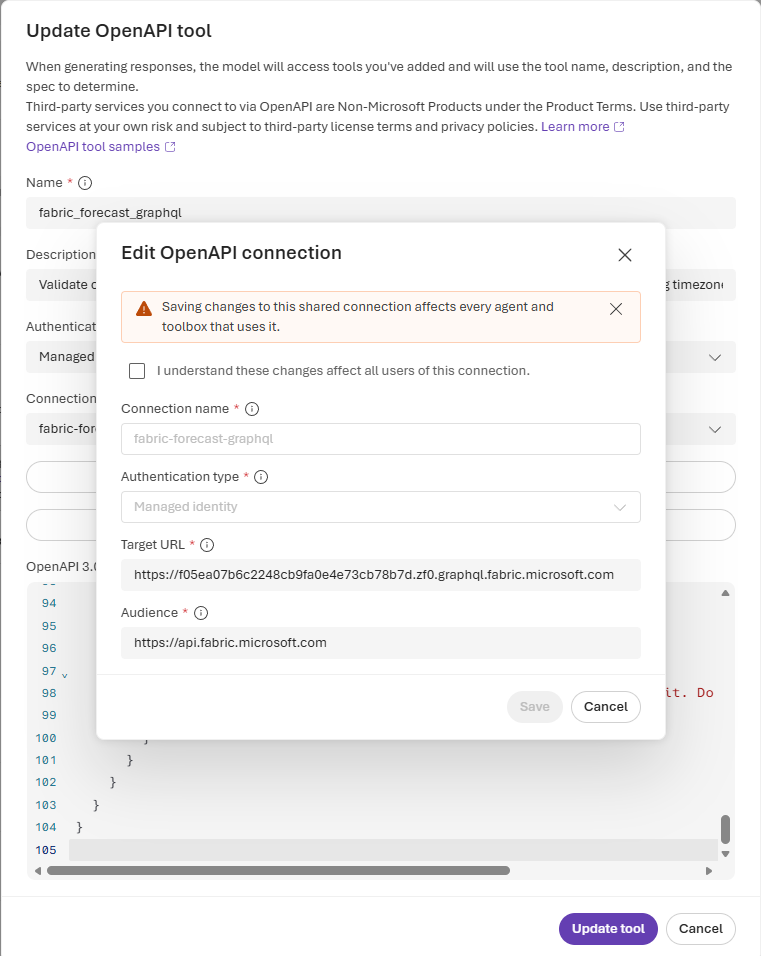

# Call Fabric GraphQL from a Foundry agent

Paste-ready configuration for **Create an OpenAPI tool** in Foundry. This calls
`executeusp_InsertForecast` directly, without running a notebook, Python script,
or interactive browser login.

Inputs: **Month** and **Scenario**. The supplied mutation has no `top_n` input.

**Latest verified deployment:** select **Fabric-GraphQLApi version 5**, which
uses **Fabric-GraphQLApi-toolbox version 5** and the **fabric-forecast-graphql**
connection. Start a fresh conversation. Version 4 points to the wrong notebook
connection; do not save or continue from that older configuration.

With your example values, the intended operation is:

```graphql
mutation {
  executeusp_InsertForecast(
    Month: "2025-02-01T00:00:00Z",
    Scenario: "Test2") {
    __typename
  }
}
```

The tool uses an equivalent named mutation with GraphQL variables so the inputs
can change without rewriting its document.

## 1. Authentication and permissions

Use the **Foundry project's managed identity**, not your local Azure CLI identity
or the parent Foundry account identity.

- Enable the project's system-assigned managed identity.
- Enable **Service principals can use Fabric APIs** (also displayed as
  **Service principals can call Fabric public APIs**) for that identity in the
  Fabric tenant settings.
- Grant the identity **Run Queries and Mutations** on GraphQL API
  `e1731935-be5f-413b-8c24-b78a250fcd70`, or use the existing workspace Contributor
  role for development. Workspace:
  `f05ea07b-6c22-48cb-9fa0-e4e73cb78b7d`.
- Grant the execution identity the necessary permissions on the underlying
  Warehouse/SQL data source and stored procedure. GraphQL API access alone does
  not prove the procedure can execute. Check the API's data-source connection
  configuration as well.

The notebook integration's project identity already received workspace
Contributor during earlier setup. That does not verify GraphQL procedure
execution or its data-source permissions.

## 2. Paste these dialog values

### Name

```text
fabric_forecast_graphql
```

### Description

```text
Validate or execute Fabric GraphQL executeusp_InsertForecast with Month (ISO 8601 date-time including timezone) and Scenario (string). Use the skipped mutation for validation only. The real mutation writes data and requires explicit user confirmation. Inspect GraphQL errors even when HTTP status is 200. Never automatically retry an insert.
```

### Authentication method

**Managed identity** (project managed identity).

### Connection

Create a **new connection** for the GraphQL host. Do not select the notebook
connection, whose target is the different `api.fabric.microsoft.com` host.
Creating the connection is not enough: select it in the GraphQL tool and save
the updated toolbox and agent versions.

| Field | Paste/select |
| --- | --- |
| Connection name | `fabric-forecast-graphql` |
| Authentication type | Managed identity (project managed identity) |
| Target URL | `https://f05ea07b6c2248cb9fa0e4e73cb78b7d.zf0.graphql.fabric.microsoft.com` |
| Audience | `https://api.fabric.microsoft.com` |


GraphQL endpoint can be extracted from the generated code by fabric


The **target** is the actual GraphQL host; the **audience** is the Entra resource
used to acquire a token. They are intentionally different. Do not use the GraphQL
host as the audience or paste an access token into any field.

Your Python example uses a delegated Power BI scope. This hosted-agent
configuration uses the Fabric resource audience supported by the service
principal documentation. A read-only call to this endpoint with a Fabric-audience
Azure CLI token was verified during preparation; the Foundry connection still
needs its own test.

### OpenAPI 3.0+ schema

Paste the entire JSON block, without the Markdown fences.

Two fixed GraphQL documents are allowed:

- With `@skip(if: true)`: validate the request without executing the procedure.
- Without that directive: execute the insert.

The inputs travel in `variables`; do not concatenate them into GraphQL source.
`Month` is declared as `DateTime!`, and `Scenario` as `String!`.

```json
{
  "openapi": "3.0.3",
  "info": {
    "title": "Fabric forecast GraphQL",
    "version": "1.0.0",
    "description": "Validate or execute the fixed InsertForecast mutation. The non-skipped mutation writes data."
  },
  "servers": [
    {
      "url": "https://f05ea07b6c2248cb9fa0e4e73cb78b7d.zf0.graphql.fabric.microsoft.com"
    }
  ],
  "paths": {
    "/v1/workspaces/f05ea07b-6c22-48cb-9fa0-e4e73cb78b7d/graphqlapis/e1731935-be5f-413b-8c24-b78a250fcd70/graphql": {
      "post": {
        "operationId": "forecast_graphql",
        "summary": "Validate or execute InsertForecast",
        "description": "Use the document with @skip(if: true) for validation without an insert. Obtain explicit confirmation before using the document without @skip. Never automatically retry an insert. HTTP 200 can contain GraphQL errors.",
        "requestBody": {
          "required": true,
          "content": {
            "application/json": {
              "schema": {
                "type": "object",
                "additionalProperties": false,
                "required": ["query", "variables"],
                "properties": {
                  "query": {
                    "type": "string",
                    "description": "Choose the skipped document for validation, or the real mutation only after confirmation.",
                    "enum": [
                      "mutation InsertForecast($Month: DateTime!, $Scenario: String!) { executeusp_InsertForecast(Month: $Month, Scenario: $Scenario) @skip(if: true) { __typename } }",
                      "mutation InsertForecast($Month: DateTime!, $Scenario: String!) { executeusp_InsertForecast(Month: $Month, Scenario: $Scenario) { __typename } }"
                    ]
                  },
                  "variables": {
                    "type": "object",
                    "additionalProperties": false,
                    "required": ["Month", "Scenario"],
                    "properties": {
                      "Month": {
                        "type": "string",
                        "format": "date-time",
                        "description": "Exact timestamp including timezone, for example 2025-02-01T00:00:00Z.",
                        "example": "2025-02-01T00:00:00Z"
                      },
                      "Scenario": {
                        "type": "string",
                        "minLength": 1,
                        "example": "Test2"
                      }
                    }
                  }
                }
              },
              "example": {
                "query": "mutation InsertForecast($Month: DateTime!, $Scenario: String!) { executeusp_InsertForecast(Month: $Month, Scenario: $Scenario) @skip(if: true) { __typename } }",
                "variables": {
                  "Month": "2025-02-01T00:00:00Z",
                  "Scenario": "Test2"
                }
              }
            }
          }
        },
        "responses": {
          "200": {
            "description": "Inspect errors before reporting success. A skipped mutation normally returns data: {}. __typename is a type name, not inserted rows or a row count.",
            "content": {
              "application/json": {
                "schema": {
                  "type": "object",
                  "properties": {
                    "data": {
                      "type": "object",
                      "nullable": true,
                      "additionalProperties": true
                    },
                    "errors": {
                      "type": "array",
                      "items": {
                        "type": "object",
                        "properties": {
                          "message": { "type": "string" },
                          "path": { "type": "array", "items": {} },
                          "extensions": { "type": "object", "additionalProperties": true }
                        },
                        "additionalProperties": true
                      }
                    }
                  },
                  "additionalProperties": true
                }
              }
            }
          },
          "default": {
            "description": "HTTP/authentication/service error. Report it. Do not automatically retry a write."
          }
        }
      }
    }
  }
}
```

The managed-identity connection supplies Authorization. There are no custom
headers to ask the model to generate. If you add headers later, declare them in
the operation's `parameters`, not in a shared path-level block, because the
earlier notebook tool failed with shared header declarations.

The tested toolbox's MCP tool discovery omitted the query enum from the schema
shown to the model, although the saved OpenAPI schema still contained it.
Keep the exact document strings in the agent instructions below. Otherwise the
model can generate valid GraphQL that fails the tool's exact-string constraint.

## 3. Paste into the agent's Instructions

```text
Use fabric_forecast_graphql to validate or execute executeusp_InsertForecast.

Collect Month and Scenario. Month must include the date, time, and timezone,
for example 2025-02-01T00:00:00Z. If the user supplies only a date or no timezone,
ask them to confirm the intended timestamp. Do not silently infer a timezone.
Preserve Scenario exactly. This operation does not accept top_n.

Put user values in variables.Month and variables.Scenario. Select one of the
two exact GraphQL documents in the tool schema. Never interpolate user input
into the query text. Do not generate other queries, fields, or mutations.
Do not omit the operation name InsertForecast or change the document's whitespace:
the query enum requires an exact match, not just equivalent GraphQL syntax.
For validation the exact query is:
mutation InsertForecast($Month: DateTime!, $Scenario: String!) { executeusp_InsertForecast(Month: $Month, Scenario: $Scenario) @skip(if: true) { __typename } }
For a confirmed write the exact query is:
mutation InsertForecast($Month: DateTime!, $Scenario: String!) { executeusp_InsertForecast(Month: $Month, Scenario: $Scenario) { __typename } }

For validation, connection checks, or dry runs, use ONLY the document containing
@skip(if: true). Explain that this validates the GraphQL request but does not
execute the stored procedure or prove that its data-source permissions work.
Do not treat validation as authorization to insert.

For an insert, summarize Month and Scenario and obtain explicit confirmation
that the user wants to write forecast data. Only after confirmation use the
document without @skip(if: true). Send exactly one request.

Inspect the tool's returned response body, parsing nested JSON response text
when necessary. HTTP 200 alone is not success. If errors is nonempty, show its
messages and do not claim the insert succeeded, even if data is also present.

For validation, data: {} with no errors means the skipped request validated;
it does not mean an insert ran. For a real mutation, report only the returned
result. __typename is just a GraphQL type name: do not claim a row count,
inserted row values, or a business outcome that the response does not provide.
If the mutation result is missing or null, report that success is unverified.

Never automatically retry an insert after a timeout, network failure,
tool_user_error, or GraphQL error. A write might already have happened.
Report the uncertainty and ask the user to verify the data before any retry.
Never request or expose access tokens, passwords, or client secrets.
```

Prompt instructions and schema enums are not an authorization boundary.
The identity can access whatever Fabric permits it to access, and callers with
control over tool definitions can change queries. Use narrowly scoped permissions.
For enforced approval, idempotency, or restricting writes to this one procedure,
put a validated backend in front of GraphQL.

## 4. Validate in Foundry without inserting

Save the tool and agent. Select the newly saved agent version and start a fresh
conversation, then paste:

```text
Validate only, with Month = "2025-02-01T00:00:00Z" and Scenario = "Test2".
Use the GraphQL document containing @skip(if: true).
Do not execute the insert.
```

Expected GraphQL body:

```json
{
  "data": {}
}
```

Foundry may wrap this body in a `response` string. Inspect that nested JSON.
This result proves request validation only, not procedure execution.

## 5. Execute deliberately

Paste:

```text
I want to insert forecast data with Month = "2025-02-01T00:00:00Z" and
Scenario = "Test2". Summarize the values and ask for confirmation before writing.
```

Only confirm if you want the write. The agent should use the non-skipped document
and send:

```json
{
  "query": "mutation InsertForecast($Month: DateTime!, $Scenario: String!) { executeusp_InsertForecast(Month: $Month, Scenario: $Scenario) { __typename } }",
  "variables": {
    "Month": "2025-02-01T00:00:00Z",
    "Scenario": "Test2"
  }
}
```

Unlike notebook submission, this is a direct GraphQL response, not a notebook job
ID that needs polling. The selected `__typename` does not return forecast rows.

## 6. Troubleshooting

| Symptom | Check |
| --- | --- |
| `tool_user_error` without a visible HTTP response | Actual connection target/audience, selected agent version, and project identity access. Use the skipped validation request, not repeated inserts. |
| GraphQL tool references `fabric-notebook-api` | Select `fabric-forecast-graphql` instead; it targets the GraphQL host. Save a new toolbox version and update the agent's toolbox reference. |
| Query differs from the enum | Preserve the exact document, including `mutation InsertForecast` and whitespace. An anonymous mutation can be valid GraphQL but still violate this tool's schema. |
| 401/403 | Project identity rather than account identity; GraphQL Execute permission; tenant policy; audience and data-source access. |
| HTTP 200 with `errors` | This is an application error, not success. Read `errors[].message` and `extensions`. |
| `Month` type error | GraphQL variable type must be `DateTime!`, not `String!`; pass an ISO 8601 timestamp as its JSON string value. |
| Introspection denied | Introspection is disabled on this API. The fixed documents here do not require it. There is no need to enable it just to call the mutation. |
| Validation succeeds but insertion fails | The skipped request never invokes SQL. Check stored-procedure permissions, data constraints, and the API's data-source connection. |
| `executeusp_InsertForecast: []` without errors | The operation completed without a GraphQL error but returned no result rows. This is not a row count; verify the underlying data separately when needed. Do not retry merely to get a nonempty result. |
| Timeout after insertion request | Outcome is unknown. Check the underlying data before another write; do not assume the procedure is idempotent. |

## Verification and references

During preparation, the endpoint accepted a read-only `query { __typename }`
using an Azure CLI token for `https://api.fabric.microsoft.com`.
The skipped mutation with `DateTime!`/`String!` variables returned `data: {}`
without errors. No insert was executed during that initial preparation.

During subsequent troubleshooting, the live GraphQL toolbox was found to reference
`fabric-notebook-api` rather than a GraphQL-host connection. A new
`fabric-forecast-graphql` managed-identity connection was created and verified.
Version 4 subsequently used the notebook connection again and generated an
operation name that did not match the query enum. **Toolbox version 5** restores
the GraphQL connection. **Agent version 5** references that toolbox and includes
both exact documents in its instructions. Existing versions and other tools
were preserved; no new Fabric permissions were granted in this troubleshooting.

Verification of version 5:

- The full saved agent generated one skipped mutation and received `data: {}`.
- A real-write request was generated behind a runtime approval gate and checked
  against the allowed document before execution.
- After explicit user approval, that single request was executed through Foundry
  with Month `2025-02-01T00:00:00Z` and Scenario `GraphQL1`. It completed without
  GraphQL errors and returned:

  ```json
  {"data":{"executeusp_InsertForecast":[]}}
  ```

- No write retry was performed. The empty result list does not report affected
  rows; underlying table contents were not independently checked.

Select **agent version 5** and start a fresh conversation. When editing the tool,
verify the connection is still **fabric-forecast-graphql** before saving new
toolbox and agent versions.

- [Connect applications to Fabric GraphQL](https://learn.microsoft.com/fabric/data-engineering/connect-apps-api-graphql)
- [Service principals, permissions, and Fabric audience](https://learn.microsoft.com/fabric/data-engineering/api-graphql-service-principal)
- [GraphQL introspection and schema export](https://learn.microsoft.com/fabric/data-engineering/api-graphql-introspection-schema-export)
- [Foundry OpenAPI tools and managed identity](https://learn.microsoft.com/azure/foundry/agents/how-to/tools/openapi)
