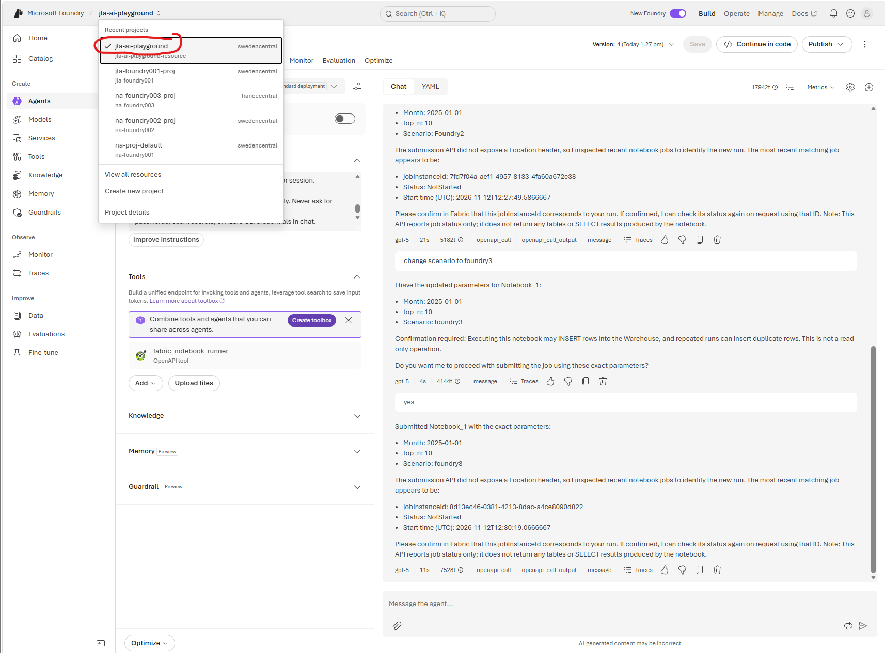
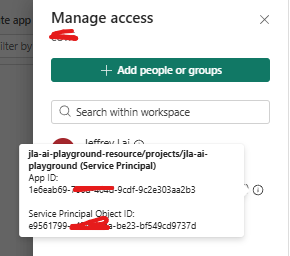
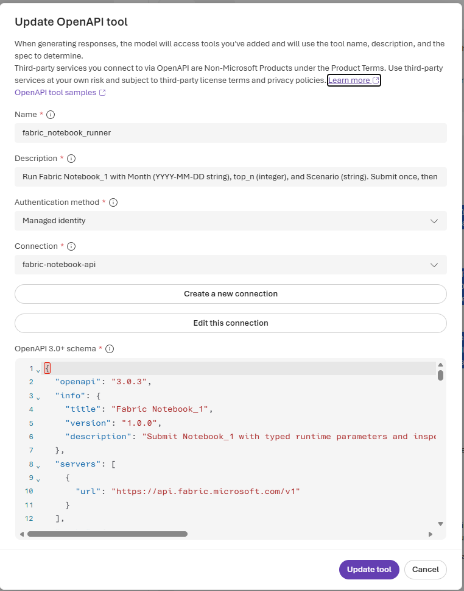

# Call Notebook_1 from a Foundry agent

This guide matches the **Create an OpenAPI tool** dialog. It calls Fabric
directly; it does not run the local PowerShell script.

## 1. Authentication and permissions (do this first)

A hosted agent cannot use your local `az login`. Use **Managed identity**,
not Anonymous. Do not paste an Azure CLI access token into the schema or agent
instructions: it expires and would expose credentials.

1. Enable the **Foundry project's managed identity** in Azure. Use its principal
   (object) ID when granting access, not your personal user or the Foundry
   account's identity. Current Foundry OpenAPI connections use project identity;
   older classic agent configurations can use account identity instead. Grant
   access to the identity actually configured for your connection.
   
2. Ask your Fabric administrator to enable **Service principals can use Fabric
   APIs**, preferably scoped to a security group containing that identity.
3. In the Fabric workspace's **Manage access**, add that managed identity with
   **Contributor** access. Workspace ID:
   `f05ea07b-6c22-48cb-9fa0-e4e73cb78b7d`.
   Azure subscription Reader/Contributor does not grant Fabric workspace access.

   
4. Ensure the workspace has active Fabric capacity.
5. Grant the execution identity access to the notebook's data sources, including
   `xxxxWarehouse`. Successful job submission does not prove that the identity can
   execute every notebook cell or access its data. Check any connector-specific
   managed-identity restrictions if the run fails.

You need permission to create project connections (currently **Foundry Project
Manager**, formerly Azure AI Project Manager).

## 2. Paste these dialog values

### Name

```text
fabric_notebook_runner
```

### Description

```text
Run Fabric Notebook_1 with Month (YYYY-MM-DD string), top_n (integer), and Scenario (string). Submit once, then inspect the returned job status. This notebook can write Warehouse data; obtain confirmation before execution. Job completion does not return SELECT result rows.
```

### Authentication method

Select **Managed identity**.

### Connection

Select **Create a new connection** and enter:

| Connection field | Value |
| --- | --- |
| Connection name | `fabric-notebook-api` |
| Authentication type | Managed identity (project managed identity) |
| Target URL | `https://api.fabric.microsoft.com` |
| Audience | `https://api.fabric.microsoft.com` |

Use the audience above, not the ARM audience (`https://management.azure.com`),
and not a token string. Select the new connection in the tool dialog.
If Managed identity is unavailable, check your Foundry project setup and
permissions; Anonymous will not work against Fabric.

### OpenAPI 3.0+ schema

Paste the **entire JSON block below**, without the Markdown fences. The workspace
and notebook are fixed in the paths. Parameter names are case-sensitive.

```json
{
  "openapi": "3.0.3",
  "info": {
    "title": "Fabric Notebook_1",
    "version": "1.0.0",
    "description": "Submit Notebook_1 with typed runtime parameters and inspect its execution. The notebook can write Warehouse data."
  },
  "servers": [
    { "url": "https://api.fabric.microsoft.com/v1" }
  ],
  "paths": {
    "/workspaces/f05ea07b-6c22-48cb-9fa0-e4e73cb78b7d/items/4a743494-5a9a-4e75-b705-7ed0a5db2fca/jobs/instances": {
      "post": {
        "operationId": "run_notebook",
        "summary": "Submit Notebook_1 once with runtime parameters",
        "description": "Requires user confirmation because notebook cells can INSERT data. HTTP 202 means accepted, not completed. Save the Location header and never automatically retry this POST.",
        "parameters": [
          {
            "name": "x-ms-fabric-skill",
            "in": "header",
            "required": true,
            "schema": { "type": "string", "enum": ["spark-cli"], "default": "spark-cli" }
          },
          {
            "name": "jobType",
            "in": "query",
            "required": true,
            "schema": { "type": "string", "enum": ["RunNotebook"], "default": "RunNotebook" }
          }
        ],
        "requestBody": {
          "required": true,
          "content": {
            "application/json": {
              "schema": {
                "type": "object",
                "required": ["executionData"],
                "properties": {
                  "executionData": {
                    "type": "object",
                    "required": ["parameters"],
                    "properties": {
                      "parameters": {
                        "type": "object",
                        "required": ["Month", "top_n", "Scenario"],
                        "properties": {
                          "Month": {
                            "type": "object",
                            "required": ["value", "type"],
                            "properties": {
                              "value": { "type": "string", "format": "date", "example": "2025-01-01" },
                              "type": { "type": "string", "enum": ["string"] }
                            }
                          },
                          "top_n": {
                            "type": "object",
                            "required": ["value", "type"],
                            "properties": {
                              "value": { "type": "integer", "minimum": 1, "example": 10 },
                              "type": { "type": "string", "enum": ["int"] }
                            }
                          },
                          "Scenario": {
                            "type": "object",
                            "required": ["value", "type"],
                            "properties": {
                              "value": { "type": "string", "minLength": 1, "example": "Jeffrey2" },
                              "type": { "type": "string", "enum": ["string"] }
                            }
                          }
                        }
                      }
                    }
                  }
                }
              },
              "example": {
                "executionData": {
                  "parameters": {
                    "Month": { "value": "2025-01-01", "type": "string" },
                    "top_n": { "value": 10, "type": "int" },
                    "Scenario": { "value": "Jeffrey2", "type": "string" }
                  }
                }
              }
            }
          }
        },
        "responses": {
          "202": {
            "description": "Accepted. The response may have no body. Location identifies the submitted job.",
            "headers": {
              "Location": { "description": "Job status URL; its final path segment is jobInstanceId.", "schema": { "type": "string" } },
              "Retry-After": { "description": "Seconds before polling.", "schema": { "type": "integer" } }
            }
          },
          "default": { "description": "Fabric error. Report it; do not blindly retry submission." }
        }
      },
      "get": {
        "operationId": "list_notebook_jobs",
        "summary": "List notebook jobs to inspect history or recover a missing job ID",
        "description": "Use if the submission Location header is not exposed by the tool. A recent job is not proof of correlation with your request. Never select an arbitrary job when several candidates exist.",
        "parameters": [
          {
            "name": "x-ms-fabric-skill",
            "in": "header",
            "required": true,
            "schema": { "type": "string", "enum": ["spark-cli"], "default": "spark-cli" }
          },
          {
            "name": "continuationToken",
            "in": "query",
            "required": false,
            "schema": { "type": "string" }
          }
        ],
        "responses": {
          "200": {
            "description": "Job history. Match IDs and timestamps; follow continuationToken when needed.",
            "content": {
              "application/json": {
                "schema": {
                  "type": "object",
                  "properties": {
                    "value": { "type": "array", "items": { "$ref": "#/components/schemas/NotebookJob" } },
                    "continuationToken": { "type": "string" },
                    "continuationUri": { "type": "string" }
                  }
                }
              }
            }
          },
          "default": { "description": "Fabric error." }
        }
      }
    },
    "/workspaces/f05ea07b-6c22-48cb-9fa0-e4e73cb78b7d/items/4a743494-5a9a-4e75-b705-7ed0a5db2fca/jobs/instances/{jobInstanceId}": {
      "get": {
        "operationId": "get_notebook_job",
        "summary": "Get the status of an existing notebook job",
        "parameters": [
          {
            "name": "jobInstanceId",
            "in": "path",
            "required": true,
            "schema": { "type": "string", "format": "uuid" }
          },
          {
            "name": "x-ms-fabric-skill",
            "in": "header",
            "required": true,
            "schema": { "type": "string", "enum": ["spark-cli"], "default": "spark-cli" }
          }
        ],
        "responses": {
          "200": {
            "description": "Job execution status, not query result rows.",
            "headers": {
              "Retry-After": { "description": "Seconds before polling.", "schema": { "type": "integer" } }
            },
            "content": {
              "application/json": {
                "schema": { "$ref": "#/components/schemas/NotebookJob" }
              }
            }
          },
          "default": { "description": "Fabric error." }
        }
      }
    }
  },
  "components": {
    "schemas": {
      "NotebookJob": {
        "type": "object",
        "properties": {
          "id": { "type": "string", "format": "uuid" },
          "itemId": { "type": "string" },
          "jobType": { "type": "string" },
          "invokeType": { "type": "string" },
          "status": { "type": "string", "description": "Completed, Failed, Cancelled, NotStarted, InProgress, or another service status." },
          "startTimeUtc": { "type": "string" },
          "endTimeUtc": { "type": "string", "nullable": true },
          "failureReason": { "type": "object", "nullable": true, "additionalProperties": true }
        }
      }
    }
  }
}
```

Authentication is supplied by the managed-identity connection. Do not add a
model-supplied Authorization header or credentials to this schema.

Declare headers inside each operation's `parameters`, not in a shared path-level
`parameters` block. In the tested Foundry runtime, the shared declaration was
missing from generated tool arguments and calls failed with `tool_user_error`.
Moving the header to the operation made the same GET succeed with the same
connection, server URL, and response schema.

## 3. Paste into the agent's Instructions

```text
You can execute Fabric Notebook_1 using fabric_notebook_runner.

Collect Month (YYYY-MM-DD), top_n (positive integer), and Scenario (nonempty string).
Ask for any missing values. Use the user's exact values and capitalization.
Never silently substitute the schema's example values.

Before calling run_notebook, summarize the parameters and obtain explicit
confirmation that execution may INSERT Warehouse rows. This is not a read-only
query tool. A repeated run can insert duplicate rows.

For run_notebook, set jobType to RunNotebook and x-ms-fabric-skill to spark-cli.
Send the body as executionData.parameters with:
Month: {"value": "<user Month>", "type": "string"}
top_n: {"value": <user integer>, "type": "int"}
Scenario: {"value": "<user Scenario>", "type": "string"}
Do not move parameters to the request body's top level.

Submit exactly once. HTTP 202 means accepted, not completed.
Capture the Location response header and extract jobInstanceId from its final
path segment. Never invent an ID. If headers are unavailable, list_notebook_jobs
can inspect history, but timestamps alone cannot conclusively correlate a job
under concurrent use. If correlation is ambiguous, report that submission may
have succeeded and ask the user to confirm the job ID in Fabric. Do not POST again.

Use get_notebook_job with that jobInstanceId and x-ms-fabric-skill=spark-cli.
Respect Retry-After if the runtime supports delayed polling. Otherwise report
the current status and job ID so the user can request another status check.
Do not run a rapid polling loop or claim you will monitor in the background.
Completed means the execution completed. Failed and Cancelled are not success;
report failureReason when available. Other statuses do not prove completion.

Do not claim that completion returned SELECT rows: this API returns job status,
not the notebook's displayed tables. Do not claim parameters change the saved
notebook defaults or an existing interactive editor session.

Report authentication/permission errors explicitly. Never ask for tokens,
passwords, client secrets, or Azure CLI credentials in chat.
```

Agent instructions are not an authorization boundary. Anyone authorized to use
this tool can exercise its configured identity's permissions. For enforced
approval, strict input validation, or read-only behavior, expose a controlled
backend instead of giving the agent direct notebook execution access.

## 4. Test in the playground

Paste:

```text
Run Notebook_1 with Month = "2025-01-01", top_n = 10, and Scenario = "Jeffrey2".
Show me the parameters before submitting and ask for confirmation.
```

After confirming, inspect the tool trace:

- The POST body must match the JSON example above.
- Expect HTTP **202**, then a job ID/status, not query rows.
- Verify the actual run in Fabric's monitoring view. The saved parameter-cell
  defaults will not change.
- Only run again deliberately: the notebook contains an INSERT.

## 5. Important limitations of this notebook

- The first cell must remain tagged `parameters`, with active assignments for
  `Month`, `top_n`, and `Scenario`. A comment saying "Parameters cell" is not enough.
- In the last inspected version, the final query used `TOP (100)` and ignored the
  three parameters. Passing parameters does not rewrite hardcoded SQL.
- The INSERT used hardcoded Scenario `Jeffrey`, not the supplied Scenario.
  Running with Scenario `Jeffrey2` does not change those inserted rows.
- Notebook SQL interpolates variables into SQL text. Do not expose this notebook
  to untrusted input without changing the SQL to use bound parameters or strict
  server-side validation. Prompt instructions and OpenAPI formats are not a
  security control.
- To return data to the agent, add an explicit, supported result-return path
  (for example a backend returning JSON). A successful execution alone is not
  a data response.
- Fabric submission can return an empty body with the job URL only in a header.
  If Foundry does not expose that header reliably, a small authenticated backend
  should submit once and return `{ "jobInstanceId": "...", "statusUrl": "..." }`
  in JSON. Do not fabricate such a body in the direct Fabric schema.

## 6. Troubleshooting

| Symptom | Check |
| --- | --- |
| 401 | Connection audience is Fabric; project identity is enabled and selected. |
| 403 | Fabric tenant setting, identity's workspace access, and data-source permissions. Azure RBAC alone is insufficient. |
| 202 with no output | Normal asynchronous acceptance; inspect the job status. |
| Job fails after 202 | Read failureReason and Fabric run logs; check connector identity support and Warehouse access. |
| Parameters appear ignored | Parameter tag, active assignments, exact case, later reassignments, and hardcoded SQL. Inspect the job run, not the interactive session. |
| No job ID in tool result | Inspect Location header; use history cautiously or introduce the JSON-returning backend described above. Never blindly resubmit. |

### Generic `tool_user_error` with no visible response

The trace's green Execute Tool span does not prove that Fabric accepted the
request. Foundry can expose only `remote tool call failed`, even when retrieving
the stored response directly.

Check the **actual connection** referenced by the failing agent version.
If its authentication type is `ProjectManagedIdentity`, compare the Foundry
**project's Identity > Object (principal) ID** with Fabric workspace access.
The parent Foundry account has a different identity. Granting Contributor to
that account identity does not authorize the project identity.

This distinction caused the access mismatch found during troubleshooting.
Contributor was added to the project identity and verified by reading the
assignment back; existing account access was left unchanged. This verifies
workspace authorization, not successful notebook execution.

There was also a schema issue: Foundry omitted the required shared path-level
header from tool arguments. A read-only test with that schema failed; moving the
header into the GET operation succeeded. The schema above includes the corrected
operation-level declarations for all three operations. After updating a tool,
save/select the new agent version and start a fresh test conversation rather
than continuing to call the old version.

Test the connection without inserting data by asking the agent:

```text
Call list_notebook_jobs only and report whether it succeeds. Do not call
run_notebook or execute the notebook.
```

Allow time for permission propagation. If the read-only call succeeds, test an
explicitly confirmed notebook run separately. If it fails, do not repeatedly
submit jobs; inspect the connection and tenant-policy diagnostics.

## References

- [Foundry OpenAPI tools and connection authentication](https://learn.microsoft.com/azure/foundry/agents/how-to/tools/openapi)
- [Classic Foundry OpenAPI tools](https://learn.microsoft.com/azure/foundry-classic/agents/how-to/tools-classic/openapi-spec)
- [Fabric notebook public APIs](https://learn.microsoft.com/fabric/data-engineering/notebook-public-api)
- [Run an item job](https://learn.microsoft.com/rest/api/fabric/core/job-scheduler/run-on-demand-item-job)
- [Get job status](https://learn.microsoft.com/rest/api/fabric/core/job-scheduler/get-item-job-instance)
- [Fabric identity support and tenant setting](https://learn.microsoft.com/rest/api/fabric/articles/identity-support)

Writing this file does not deploy an integration. During subsequent
troubleshooting, the existing connection was inspected and the project
identity's Fabric workspace Contributor assignment was added with approval and
verified. The operation-level header fix was also verified through Foundry with
read-only job-history calls. No notebook run was started by these diagnostics.
The corrected tool was saved in **Fabric-API version 3** and read back to verify
all three operation-level header declarations. Select version 3 and start a new
conversation when testing; version 2 remains unchanged.
